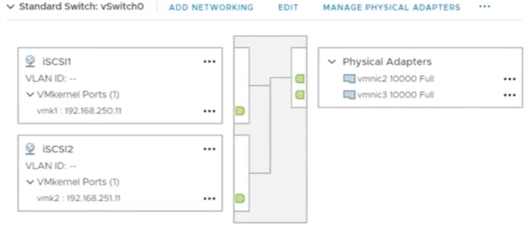

# ESXi1 (Dell PowerEdge R710)

- iscsi vmk1 (`10.10.110.11/24`) -> v-ss1 (jumbo frame) -> vmnic1 -> sw1 vlan 110

- iscsi vmk2 (`10.10.120.11/24`) -> v-ss1 (jumbo frame) -> vmnic2 -> sw2 vlan 120

- Notes

    - One `vmk` is mapped to one `vmnic` (**MPIO**)

    - One storage adapter (`vmhba64`) is mapped to multiple `iscsi vmk` ports

# ESXi2 (Dell PowerEdge R710)

- iscsi vmk1 (`10.10.110.12/24`) -> v-ss1 (jumbo frame) -> vmnic1 -> sw1 vlan 110

- iscsi vmk2 (`10.10.120.12/24`) -> v-ss1 (jumbo frame) -> vmnic2 -> sw2 vlan 120

# MSA Controller A (HPE MSA 2040)

- Port 1: `10.10.110.101/24` - VLAN 110

- Port 2: `10.10.120.101/24` - VLAN 120

# MSA Controller B (HPE MSA 2040)

- Port 1: `10.10.110.102/24` - VLAN 110

- Port 2: `10.10.120.102/24` - VLAN 120

# Images

# Configuration Steps

## Create VMK and VSS

- Configure Tab > Networking > Virtual Switches > Add Networking Button

- Select Connection Type (3 options)

    - VMKernel Network Adapter *

    - Virtual Machine Port Group for a Standard Switch

    - Physical Network Adapter

- Select Target Device > New Standard Switch > MTU (Bytes) 9000 > Assign Adapters (vmnics) to the VSS

## Storage Software Adapters: Network Port Binding & Dynamic Discovery

- Storage > Storage Adapters > `vmhba64`

- **Network Port Binding** > Map the adapter `vmhba` to multiple `vmk` ports

- Go to **Dynamic Discovery** > Add > Add the `IPs of the SAN Ports` > Rescan Storage