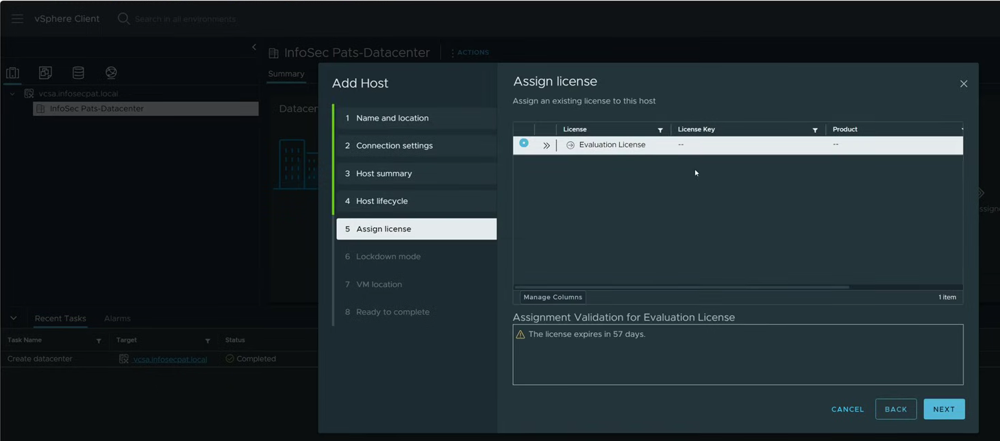

# Licensing

- Back when vSphere 5.5, VMware used a CapEx perpetual licensing model

    - You bought a key once for a specific software version, and it belonged to you indefinitely

- Instead of subscription tiers or billing by CPU core counts, licensing was **based on physical CPU sockets** and all-in-one product bundles

    - Some hardware vendors (such as Dell, HP, or Cisco) allow you to bundle or purchase a **vSphere/ESXi OEM license** alongside the server hardware
    
    - But you must explicitly select and pay for it as an add-on during the purchase order

    - A **vSphere/ESXi OEM license** is a VMware vSphere or ESXi software license purchased directly through an Original Equipment Manufacturer (OEM) — such as Dell, HP, Lenovo, or Cisco

- `vSphere Essentials Plus` License

    - `vSphere Essentials` License allows only 2 hosts, and NO `vSphere HA` and `vMotion`

    - When purchasing a legacy vSphere Essentials Plus Kit, VMware issued two main serial keys
    
        - One license key (or key file) for the ESXi host package 
        
        - One license key for vCenter Server

    - We can buy VMware licenses directly with the physical server hardware—known as an OEM (Original Equipment Manufacturer) license

- How Licensing Registration Works in the Cluster

    - The host license key isn't locked to one machine; it acts as a pool of 6 CPU socket entitlements

    - When you add your first dual-socket Dell R710 to vCenter and enter the host license key, it consumes 2 CPU capacity units, leaving 4 remaining

    - Adding the third dual-socket R710 consumes the final 2 CPU units (reaching the 6-CPU max limit)

    - You log into the VCSA management interface, go to Licensing, and enter the vCenter Server Essentials key

    - This unlocks vCenter management capabilities and enables cluster-wide features (vSphere HA, vMotion, and vSphere Replication) across the hosts assigned to that inventory

    - This key is hard-coded to allow management of up to 3 hosts. If you attempt to add a 4th host to that vCenter instance, vCenter blocks the operation, regardless of CPU counts

    - Assign the Key to Your ESXi Hosts

        

# Steps

- Install ESXi

- Join ESXi Host to Active Directory Domain

- Deploy VCSA VM to an ESXi Host

- Add other ESXi Hosts to VCSA

- Join VCSA VM to Active Directory Domain